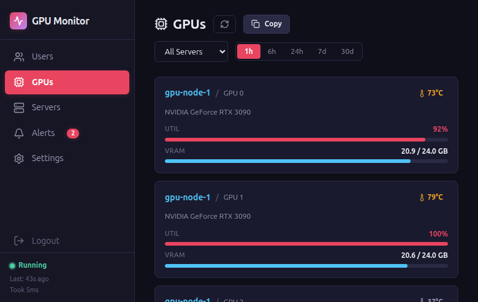
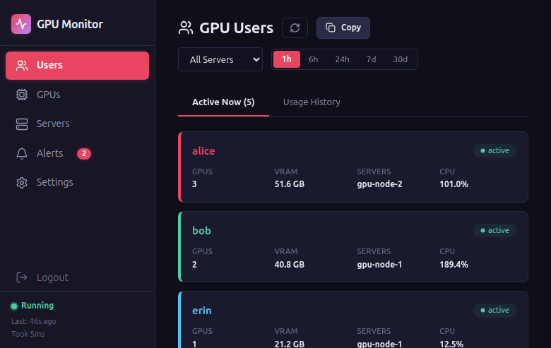
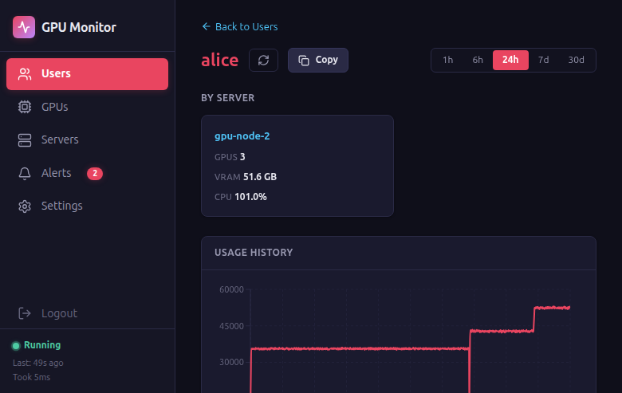
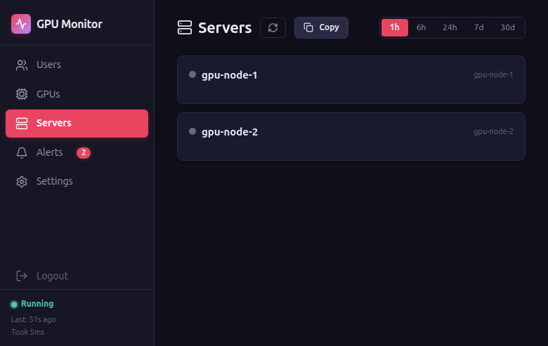
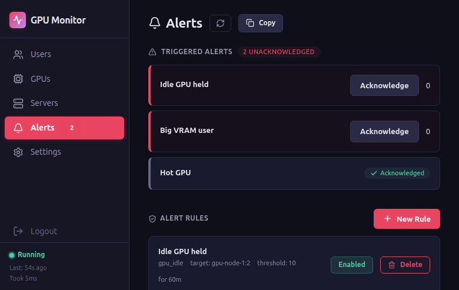
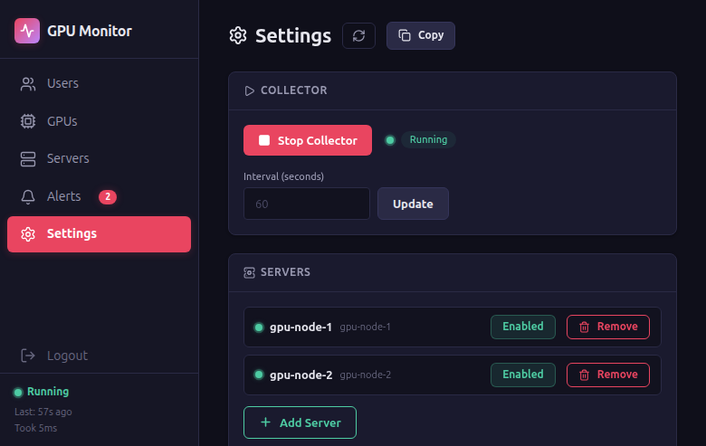

# GPU Monitor

A self-hosted dashboard for monitoring NVIDIA GPUs across multiple servers. Collects `nvidia-smi` data over SSH, stores it in SQLite, and serves a React frontend with real-time views of GPU utilization, users, servers, and alerts.



## Features

- **GPU Overview** — utilization, VRAM, temperature per GPU across all servers
- **User Tracking** — see who's using which GPUs, active sessions, and usage history
- **Server Management** — add/remove servers, monitor connectivity status
- **Alerts** — configurable rules (GPU temp, memory threshold, etc.) with duration-based evaluation
- **Authentication** — password-protected web UI
- **Auto Collection** — scheduled SSH-based data collection with configurable intervals
- **Data Retention** — automatic cleanup of old data and log files

<details>
<summary>More screenshots</summary>

| Users | User Detail |
|-------|-------------|
|  |  |

| Servers | Alerts |
|---------|--------|
|  |  |

| Settings |
|----------|
|  |

</details>

## Quick Start (Docker)

```bash
# Clone the repo
git clone https://github.com/Nghiauet/GPU-monitor.git
cd GPU-monitor

# Set up config
cp config.example.json config.json   # edit with your server details
cp .env.example .env                 # set GPU_MONITOR_PASSWORD

# Start
docker compose up -d
```

The dashboard will be available at `http://localhost:8267`.

## Manual Setup

Requires **Node.js 20+** and SSH access to your GPU servers.

```bash
# Install dependencies
cd server && npm install && cd ..
cd client && npm install && cd ..

# Configure
cp config.example.json config.json   # add your servers
cp .env.example .env                 # set GPU_MONITOR_PASSWORD

# Start (production — builds frontend, serves on :3001)
./start.sh

# Or start in development mode (backend :3001 + Vite HMR :3000)
./start.sh dev
```

## Configuration

### config.json

```json
{
  "servers": [
    {
      "name": "gpu-server-1",
      "hostname": "gpu-server-1",
      "ssh_user": "your_username",
      "ssh_key_path": "~/.ssh/id_ed25519",
      "enabled": true
    }
  ],
  "interval_seconds": 60,
  "log_dir": "./logs",
  "retention_days": 30
}
```

- `hostname` must match an entry in your `~/.ssh/config` (for port, HostName, etc.)
- `ssh_key_path` — path to the SSH private key for connecting to the server
- `interval_seconds` — how often to collect data (in seconds)
- `retention_days` — auto-delete data older than this

### .env

```
GPU_MONITOR_PASSWORD=your_password_here
```

## Architecture

```
collect.sh (bash/SSH) --> JSONL files --> ingestion --> SQLite <-- REST API <-- React frontend
                                                         ^
                                                    alerts engine
```

1. **Collector** (`collect.sh`) — SSHes into each server, runs `nvidia-smi` / `ps` / `top`, writes JSONL files
2. **Ingestion** (`server/src/ingestion.js`) — parses JSONL, deduplicates, batch-inserts into SQLite
3. **Alerts** (`server/src/alerts.js`) — evaluates rules against recent data after each collection
4. **API** (`server/src/routes/`) — Express REST endpoints with token-based auth
5. **Frontend** (`client/`) — React + Vite SPA with Recharts for visualization

## Running Tests

```bash
cd server && npx vitest run
```

## Tech Stack

- **Backend:** Node.js, Express, better-sqlite3
- **Frontend:** React 18, React Router, Recharts, Lucide icons, Vite
- **Collection:** Bash, SSH, nvidia-smi
- **Database:** SQLite (WAL mode)
- **Deployment:** Docker, Docker Compose

## License

MIT
